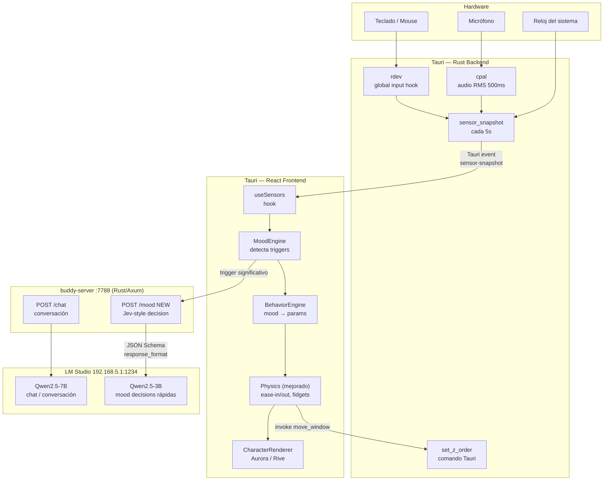

# Behavior Engine + Sensory Layer — Design Spec

**Goal:** Hacer que Buddy se vea vivo y reaccione al contexto real del usuario mediante sensores de entrada, un motor de decisiones Jev-style y física orgánica.

**Approach:** Híbrido event-driven — el motor local maneja el movimiento sin latencia; sensores disparan llamadas al LLM solo en cambios significativos de contexto; el LLM devuelve clasificaciones estructuradas (no texto libre) via JSON Schema.

---

## Arquitectura completa



---

## Flujo de datos completo

```
1. Rust recoge sensores cada 500ms (mic) / en tiempo real (teclado)
2. Cada 5s emite SensorSnapshot vía evento Tauri → React
3. useSensors normaliza y expone el snapshot
4. MoodEngine compara snapshot con estado anterior:
   ├── Sin cambio significativo → usa mood actual (sin llamada al LLM)
   └── Trigger detectado → llama POST /mood en buddy-server
5. buddy-server llama LM Studio con JSON Schema → recibe MoodDecision garantizado
6. MoodDecision se almacena con TTL de 10 minutos
7. BehaviorEngine lee mood cada frame → calcula parámetros de movimiento
8. Physics ejecuta movimiento con easing + micro-fidgets
9. CharacterRenderer anima el personaje
10. Si z_order cambió → invoke('set_z_order') en Tauri
```

---

## Módulos nuevos

### `packages/core/src/sensor-bus.ts`

```typescript
export type InputLevel = 'idle' | 'light' | 'heavy'

export interface SensorSnapshot {
  timestamp: number
  mic: {
    active: boolean
    level: number        // 0-1 volumen RMS
  }
  input: {
    keyRate: number      // teclas por minuto últimos 60s
    mouseDistance: number
    level: InputLevel
    idleDuration: number // ms desde último input
  }
  time: {
    hour: number
    isNight: boolean     // 22h-6h
    isWeekend: boolean
  }
}
```

### `packages/core/src/mood-engine.ts`

```typescript
export type MoodName = 'playful' | 'focused' | 'tired' | 'curious' | 'calm' | 'sleepy'
export type ZOrder   = 'top' | 'normal' | 'behind'
export type EnergyLevel = 'very_low' | 'low' | 'medium' | 'high' | 'very_high'
export type RestLevel   = 'still' | 'slow' | 'normal' | 'active' | 'restless'

export interface Mood {
  name: MoodName
  energy: EnergyLevel
  restlessness: RestLevel
  zOrder: ZOrder
  expiresAt: number    // Date.now() + TTL
}
```

**Triggers que disparan llamada al LLM** (máximo 1 cada 2 min):

| Trigger | Condición |
|---------|-----------|
| Usuario idle | `idleDuration > 5 min` |
| Usuario volvió | `idle → heavy` |
| Voz detectada | `mic.active` por >3s sostenidos |
| Cambio de turno | hora cruza 6h, 13h, 18h, 22h |
| Mood expiró | `expiresAt < now` && Buddy idle |

**Fallback sin LLM** (por hora del día):

| Hora | Mood | Energy |
|------|------|--------|
| 6–9h | calm | low |
| 9–13h | curious | medium |
| 13–15h | tired | very_low |
| 15–19h | playful | high |
| 19–22h | calm | medium |
| 22–6h | sleepy | very_low |

### `packages/core/src/behavior-engine.ts`

Traduce `Mood` a parámetros concretos de movimiento:

```typescript
export interface BehaviorParams {
  walkFrequencyMs: number   // cada cuánto camina
  walkSpeedPx: number       // px/s
  walkRadius: number        // radio máximo desde posición actual
  fidgetEnabled: boolean    // micro-movimientos idle
  fidgetIntervalMs: number  // cada cuánto fidgetea
  fidgetRadiusPx: number    // amplitud del fidget
}
```

Tabla de traducción:

| Mood | walkFreq | speed | radius | fidget |
|------|----------|-------|--------|--------|
| playful high | 4s | 140px/s | 400px | sí, 3s, 15px |
| focused low | 30s | 40px/s | 80px | no |
| curious medium | 8s | 90px/s | 300px | sí, 6s, 8px |
| tired very_low | 45s | 25px/s | 120px | no |
| sleepy very_low | 60s | 15px/s | 60px | no |

### `apps/desktop/src-tauri/src/sensors.rs` (Rust nuevo)

- **Mic**: `cpal` — captura stream de audio, calcula RMS cada 500ms, emite evento si supera threshold
- **Input**: `rdev` — hook global, cuenta keystrokes/mouse_distance por ventana de 60s
- **Emit**: `app.emit("sensor-snapshot", snapshot)` cada 5s

```rust
// Nuevo comando Tauri
#[tauri::command]
fn set_z_order(window: tauri::Window, on_top: bool) -> Result<(), String> {
    window.set_always_on_top(on_top).map_err(|e| e.to_string())
}
```

### `server/src/routes/mood.rs` (Rust nuevo)

Endpoint `POST /mood` en buddy-server:

**Request:**
```json
{
  "hour": 14,
  "is_night": false,
  "input_level": "heavy",
  "idle_duration_min": 0,
  "mic_active": false,
  "current_mood": "calm"
}
```

**Llama a LM Studio con JSON Schema garantizado:**
```json
{
  "model": "qwen2.5-3b-instruct",
  "messages": [{ "role": "user", "content": "..." }],
  "response_format": {
    "type": "json_schema",
    "json_schema": {
      "name": "mood_decision",
      "strict": true,
      "schema": {
        "type": "object",
        "properties": {
          "mood":         { "enum": ["playful","focused","tired","curious","calm","sleepy"] },
          "energy":       { "enum": ["very_low","low","medium","high","very_high"] },
          "restlessness": { "enum": ["still","slow","normal","active","restless"] },
          "z_order":      { "enum": ["top","normal","behind"] }
        },
        "required": ["mood","energy","restlessness","z_order"],
        "additionalProperties": false
      }
    }
  }
}
```

**Response:**
```json
{ "mood": "focused", "energy": "low", "restlessness": "still", "z_order": "behind" }
```

Sin parsing frágil. Sin alucinaciones. Siempre válido.

---

## Physics mejorado — `apps/desktop/src/physics.ts`

**1. Ease-in/out (smoothstep)**
```typescript
function smoothstep(t: number): number {
  return t * t * (3 - 2 * t)
}
// velocidad actual = speed × smoothstep(progress hacia destino)
```

**2. Micro-fidgets idle**
```typescript
// Mientras idle && fidgetEnabled && tiempo > fidgetIntervalMs:
//   generar target a fidgetRadiusPx en dirección aleatoria
//   mover suavemente y regresar
```

**3. Timing orgánico (Gaussian)**
```typescript
// Reemplaza Math.random() * range + base
// por gaussian(mean=base, std=base*0.4)
// Resultado: pausas irregulares, no mecánicas
```

---

## Configuración LM Studio

El buddy-server ya usa `OLLAMA_URL` env var para apuntar al LLM. Para LM Studio local:

```
OLLAMA_URL=http://192.168.5.1:1234
LLM_MODEL=qwen2.5-7b-instruct      # para /chat
MOOD_MODEL=qwen2.5-3b-instruct     # para /mood (nuevo env var)
```

**Modelo recomendado para descargar en LM Studio:**
- Chat: `Qwen/Qwen2.5-7B-Instruct-GGUF` → `Q4_K_M` (~4.7GB)
- Mood: `Qwen/Qwen2.5-3B-Instruct-GGUF` → `Q4_K_M` (~2.0GB)

Ambos soportan `response_format.json_schema` nativo.

---

## Archivos modificados

| Archivo | Cambio |
|---------|--------|
| `packages/core/src/sensor-bus.ts` | NUEVO |
| `packages/core/src/mood-engine.ts` | NUEVO |
| `packages/core/src/behavior-engine.ts` | NUEVO |
| `packages/core/src/index.ts` | exportar los 3 nuevos |
| `apps/desktop/src-tauri/src/sensors.rs` | NUEVO |
| `apps/desktop/src-tauri/src/main.rs` | registrar sensors + set_z_order |
| `apps/desktop/src-tauri/Cargo.toml` | agregar cpal, rdev |
| `apps/desktop/src/hooks/useSensors.ts` | NUEVO |
| `apps/desktop/src/physics.ts` | easing + fidgets + gaussian timing |
| `apps/desktop/src/BuddyOverlay.tsx` | integrar BehaviorParams + useSensors |
| `server/src/routes/mood.rs` | NUEVO |
| `server/src/routes/mod.rs` | exponer mood |
| `server/src/main.rs` | registrar ruta /mood |
| `server/src/state.rs` | agregar MOOD_MODEL env var |

---

## Lo que NO entra en este spec (siguientes subsistemas)

- MCP tools (web search, control de computadora)
- Protocolo propio universal
- Memoria persistente larga
- Cámara / visión
- Instalación cross-device
